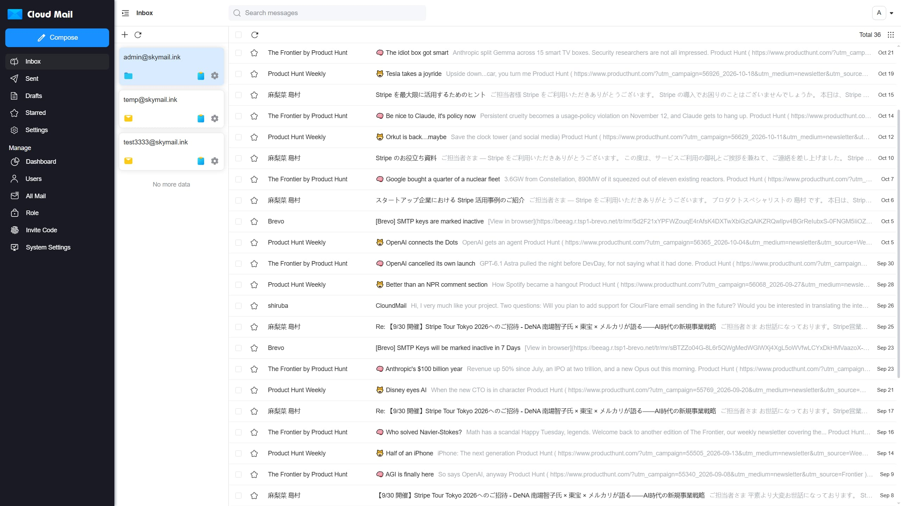
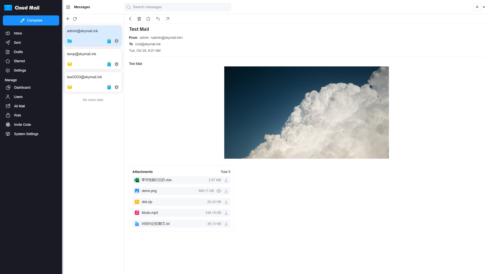
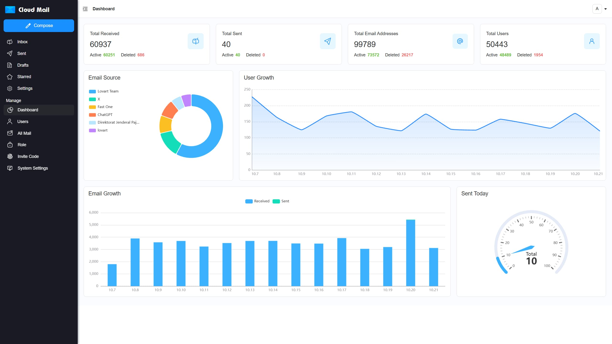
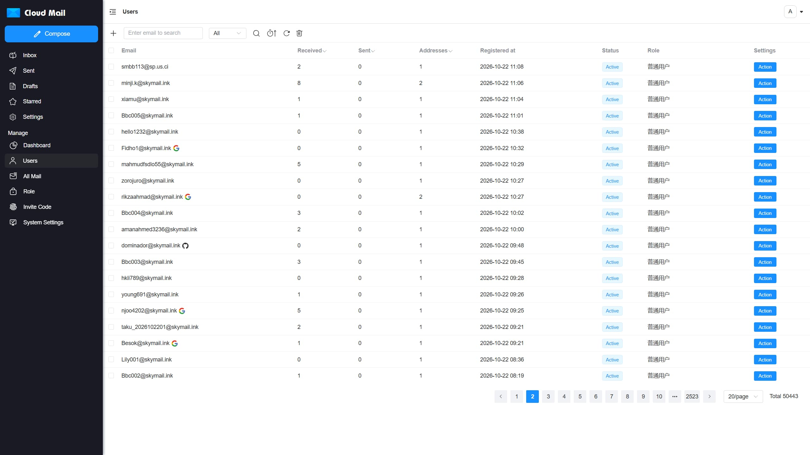

<p align="center">
    
    <h1 align="center">Cloud Mail</h1>
    <p align="center">An all-in-one email service platform powered by Cloudflare</p>
    <p align="center">
        <a href="/README.md">简体中文</a> | English
    </p>
</p>

## Description
With only one domain, you can create multiple different email addresses, similar to major email platforms. This project can be deployed on Cloudflare Workers to reduce server costs and build your own email service.

This fork adds random email generation, public email sharing, expired email cleanup, all-mailbox aggregation, auth-page domain display, sidebar visibility control, and deployment diagnostics for temporary receiving, public sharing, and more detailed admin management.

## Project Showcase

|   |  |
|-----------------------------|-----------------------------|
|  |  |

## Features

- **💰 Low-Cost Usage**: No server required — deploy to Cloudflare Workers to reduce costs.

- **💻 Responsive Design**: Automatically adapts to both desktop and most mobile browsers.

- **📧 Email Sending**: Integrated with Cloudflare Email and Resend for sending email.

- **🛡️ Admin Features**: Admin controls for user and email management with RBAC-based access control.

- **📦 Attachment Support**: Send and receive attachments, stored and downloaded via R2 object storage.

- **🔔 Email Push**: Forward received emails to Telegram bots or other email providers.

- **📡 Open API**: Supports batch user creation via API and multi-condition email queries

- **🔢 Verification Code Recognition**: Auto-detect codes via Workers AI

- **📈 Data Visualization**: Use ECharts to visualize system data, including user email growth.

- **🎨 Personalization**: Customize website title, login background, and transparency.

- **🤖 CAPTCHA**: Integrated with Turnstile CAPTCHA to prevent automated registration.

- **📜 More Features**: Under development...

## Fork Enhancements

- **🎲 Random Email**: Generate random addresses by domain, length, character mode, and role quota, with a read-only random inbox.

- **🔗 Email Sharing**: Create public share links for registered accounts or random addresses, and manage or delete share links while viewing email counts and visits.

- **🧹 Expired Email Cleanup**: Filter and batch-delete expired messages by retention days, with optional daily automatic cleanup.

- **📬 All-Mailbox Views**: Inbox and Sent can show all mailboxes for the current user in one aggregated view.

- **🌐 Auth Domain Display**: Configure the domains shown on login/register pages without changing mail delivery, registration validation, or permission rules.

- **🧭 Sidebar Control**: Control sidebar menu visibility from system settings, with the Debug entry hidden by default and enabled on demand.

- **🩺 Debug Diagnostics**: Check deployment config, current user state, random email, share APIs, cache, and frontend resources to diagnose blank-screen and deployment issues.

## Tech Stack

- **Platform**: [Cloudflare Workers](https://developers.cloudflare.com/workers/)

- **Web Framework**: [Hono](https://hono.dev/)

- **ORM**: [Drizzle](https://orm.drizzle.team/)

- **Frontend Framework**: [Vue3](https://vuejs.org/)

- **UI Framework**: [Element Plus](https://element-plus.org/)

- **Email Sending**: [Cloudflare Email](https://developers.cloudflare.com/email-service/) / [Resend](https://resend.com/)

- **Cache**: [Cloudflare KV](https://developers.cloudflare.com/kv/)

- **Database**: [Cloudflare D1](https://developers.cloudflare.com/d1/)

- **File Storage**: [Cloudflare R2](https://developers.cloudflare.com/r2/)

## Project Structure

```
cloud-mail
├── mail-worker                    # Backend worker project
│   ├── src
│   │   ├── api                    # API layer
│   │   ├── const                  # Project constants
│   │   ├── dao                    # Data access layer
│   │   ├── email                  # Email processing and handling
│   │   ├── entity                 # Database entities
│   │   ├── error                  # Custom exceptions
│   │   ├── hono                   # Web framework, middleware, error handling
│   │   ├── i18n                   # Internationalization
│   │   ├── init                   # Database and cache initialization
│   │   ├── model                  # Response data models
│   │   ├── security               # Authentication and authorization
│   │   ├── service                # Business logic layer
│   │   ├── template               # Message templates
│   │   ├── utils                  # Utility functions
│   │   └── index.js               # Entry point
│   ├── package.json               # Project dependencies
│   └── wrangler.toml              # Project configuration
│
├── mail-vue                       # Frontend Vue project
│   ├── src
│   │   ├── axios                  # Axios configuration
│   │   ├── components             # Custom components
│   │   ├── echarts                # ECharts integration
│   │   ├── i18n                   # Internationalization
│   │   ├── init                   # Startup initialization
│   │   ├── layout                 # Main layout components
│   │   ├── perm                   # Permissions and access control
│   │   ├── request                # API request layer
│   │   ├── router                 # Router configuration
│   │   ├── store                  # Global state management
│   │   ├── utils                  # Utility functions
│   │   ├── views                  # Page components
│   │   ├── app.vue                # Root component
│   │   ├── main.js                # Entry JS file
│   │   └── style.css              # Global styles
│   ├── package.json               # Project dependencies
└── └── env.release                # Environment configuration

```

## License

This project is licensed under the [MIT](LICENSE) license.

## Communication

[Telegram](https://t.me/cloud_mail_tg)
